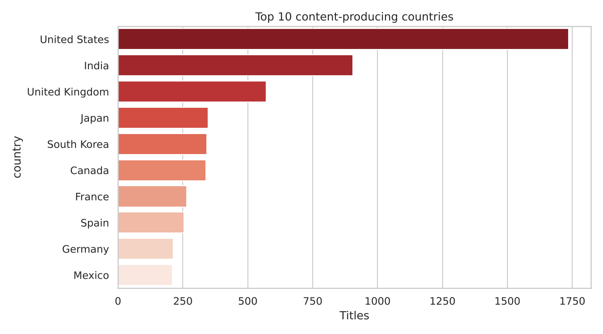
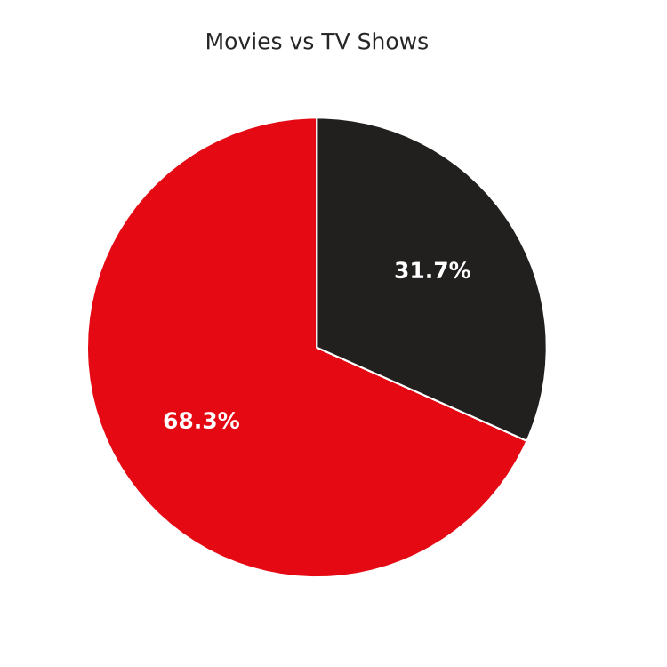
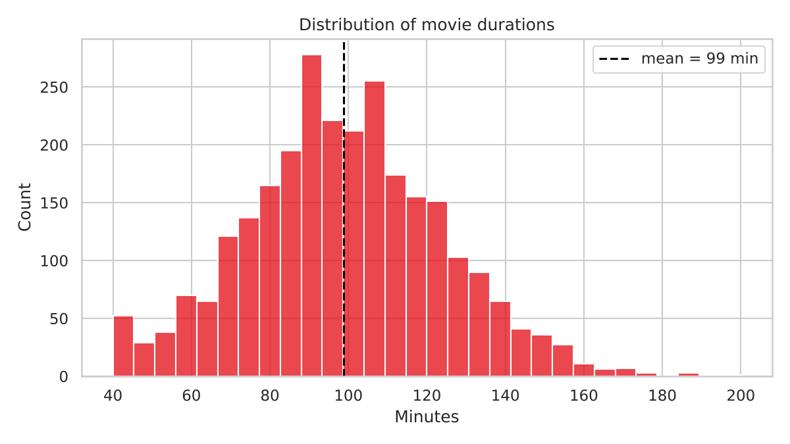
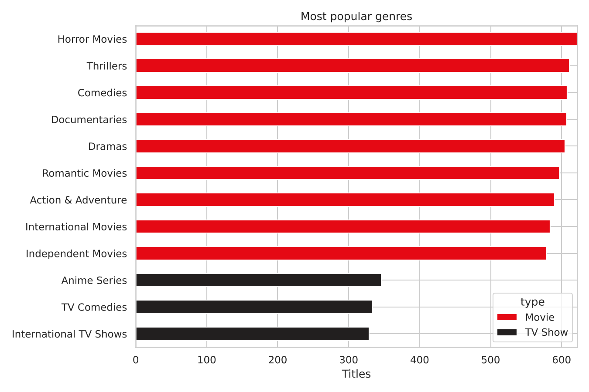
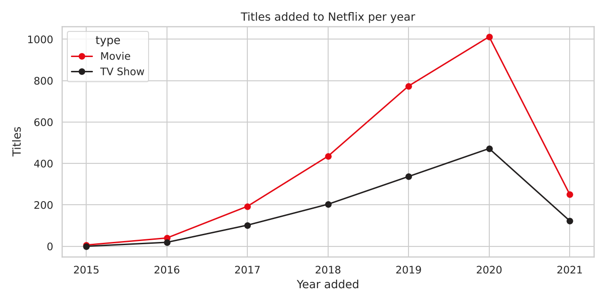
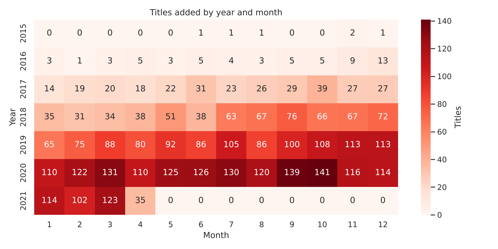
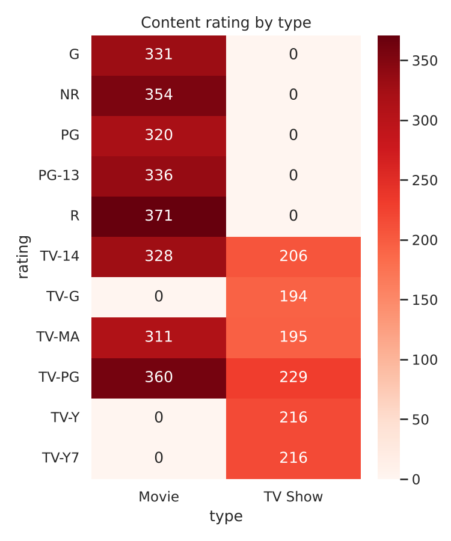

# Netflix Data Analysis

**Level:** Beginner  
> Cleaning and exploring Netflix's catalogue to see what it streams, where it comes from and how it has grown.

> **Before you publish:** this repo ships with a *synthetic sample dataset* in the same format as the real one so everything runs out of the box. Download the real dataset (see below), put it at `data/netflix_titles.csv`, re-run, and replace the Key Insights section with your real numbers. Then delete this note.

## Business questions

- Which country produces the most content?
- Movies vs TV shows - what is the split?
- What is the average movie duration?
- Which genres are most popular?
- How much content was added each year?

## Dataset

- Netflix Movies and TV Shows (Kaggle) - `netflix_titles.csv`
- Expected location: `data/netflix_titles.csv` (search the dataset name on Kaggle to download it)
- If the file is missing, `generate_data.py` creates a sample with the same columns automatically.

## Skills demonstrated

Pandas, data cleaning, missing values, groupby, `explode` on multi-value columns, date parsing, Matplotlib/Seaborn

## Project structure

```
README.md
analysis.ipynb         notebook (cells run top to bottom)
analysis.py            same analysis as a script
cleaned_dataset.csv
images/               charts used in this README
data/                 raw data goes here
generate_data.py      sample-data generator
requirements.txt
```

## How to run

```bash
pip install -r requirements.txt
python analysis.py             # or: jupyter notebook analysis.ipynb
```

## Key insights

_Run the analysis and paste the five printed insights here, each with a recommendation. Example format:_

1. **Finding with a number** - e.g. "Month-to-month contracts churn at 3x the rate of two-year contracts."
   - *Recommendation:* what the business should do about it.
2. ...

## Visualizations









## Interview talking points

- Why I kept rows with missing director/cast (filled with 'Unknown') but dropped rows with no `date_added`.
- How `explode()` turns a comma-separated country/genre column into analysable rows (and why that double-counts co-productions).

## Resume bullet (fill in your numbers)

> Cleaned and analysed [N]+ Netflix titles with Pandas; identified [top country] as the largest producer and a [X]% growth in titles added between [year] and [year].

## Tech stack

Python, Pandas, NumPy, Matplotlib, Seaborn, Jupyter
